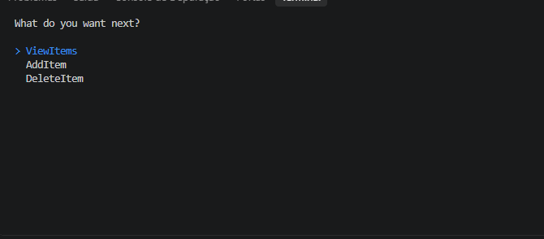

# Sistema de Gerenciamento de Biblioteca

Um sistema de gerenciamento de biblioteca desenvolvido em C# como parte dos meus estudos de Programação Orientada a Objetos (POO).

O projeto foi desenvolvido acompanhando um tutorial do thecsharpacademy.com, com o objetivo de praticar conceitos de orientação a objetos por meio de uma aplicação de terminal.

## Sobre o projeto

A aplicação permite gerenciar diferentes tipos de itens de uma biblioteca por meio de um menu interativo no terminal.

### Funcionalidades

* Cadastro e listagem de itens da biblioteca.
* Gerenciamento de livros, revistas e jornais.
* Seleção de itens para exclusão.
* Verificação de títulos duplicados.
* Interface de terminal interativa.

## Tecnologias utilizadas

* **C#** — linguagem de programação.
* **.NET** — plataforma de desenvolvimento.
* **Spectre.Console** — biblioteca utilizada para criar menus e melhorar a apresentação no terminal.

## Conceitos praticados

Durante o desenvolvimento, pratiquei os seguintes conceitos:

* Classes e objetos.
* Herança e classes abstratas.
* Interfaces e polimorfismo.
* Encapsulamento e organização de responsabilidades.
* Manipulação de coleções.
* Organização do código em diferentes arquivos e classes.

## Como executar

### Pré-requisitos

* SDK do .NET compatível com o projeto.
* Git (opcional, caso queira clonar o repositório).

### Instalação

1. Clone o repositório:

   ```bash
   git clone [URL_DO_REPOSITORIO]
   ```

2. Entre na pasta do projeto:

   ```bash
   cd [NOME_DA_PASTA]
   ```

3. Execute o projeto:

   ```bash
   dotnet run
   ```

Se o arquivo `.csproj` estiver em uma subpasta, entre nela antes de executar o comando.

## Aprendizados

Este projeto me mostrou como aplicar conceitos de POO que eu conheci anteriormente, em C# com um sistema prático. Me ensinando sobre a sintaxe de C# e me ajudando a compreender melhor como organizar classes, interfaces e responsabilidades.

## Demonstração



## Créditos

Projeto desenvolvido para fins de estudo, acompanhando o tutorial:

[Introduction to Object Oriented Programming](https://thecsharpacademy.com/dashboard/Courses)
